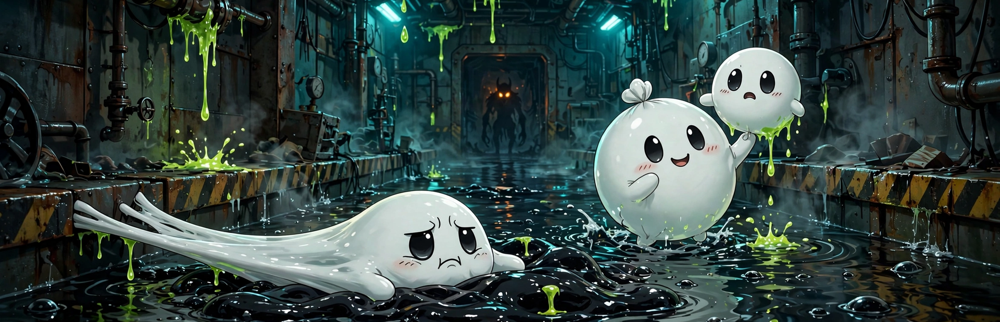
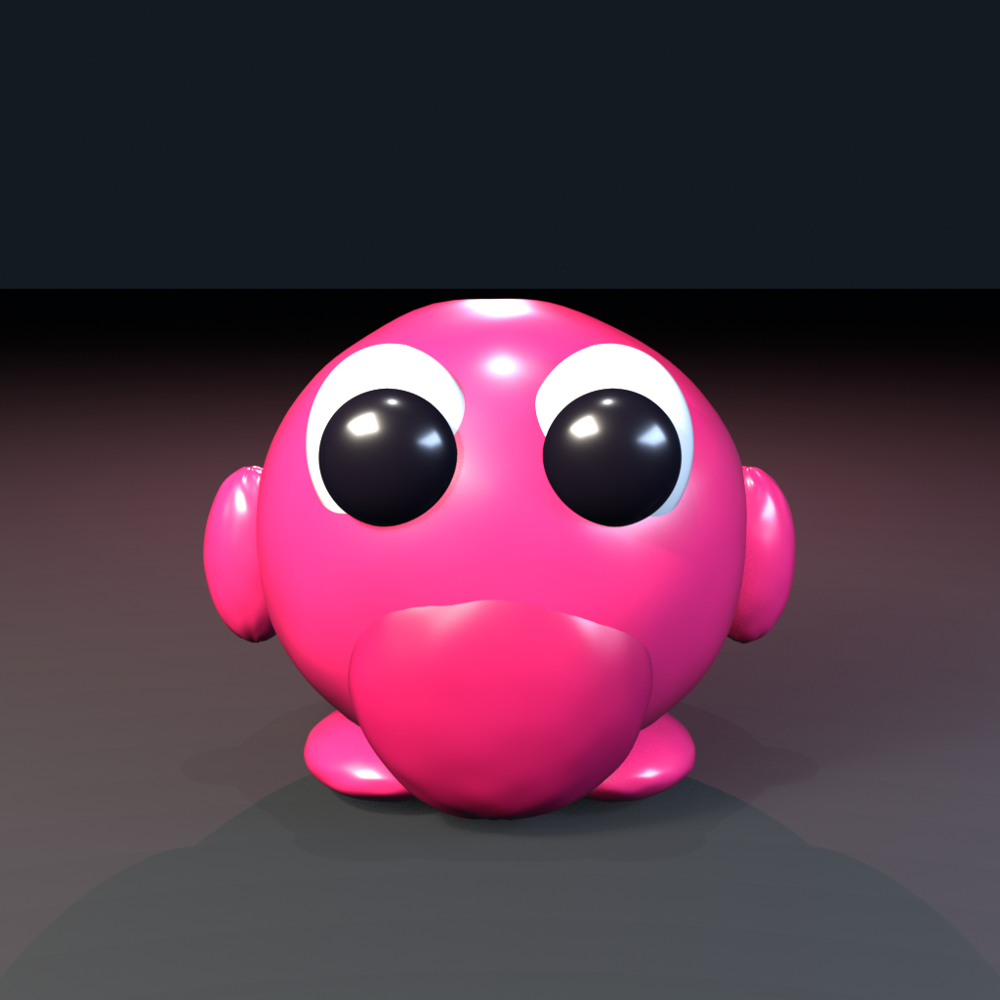
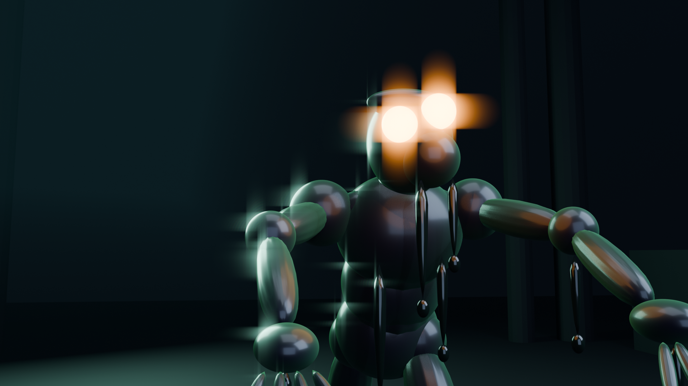
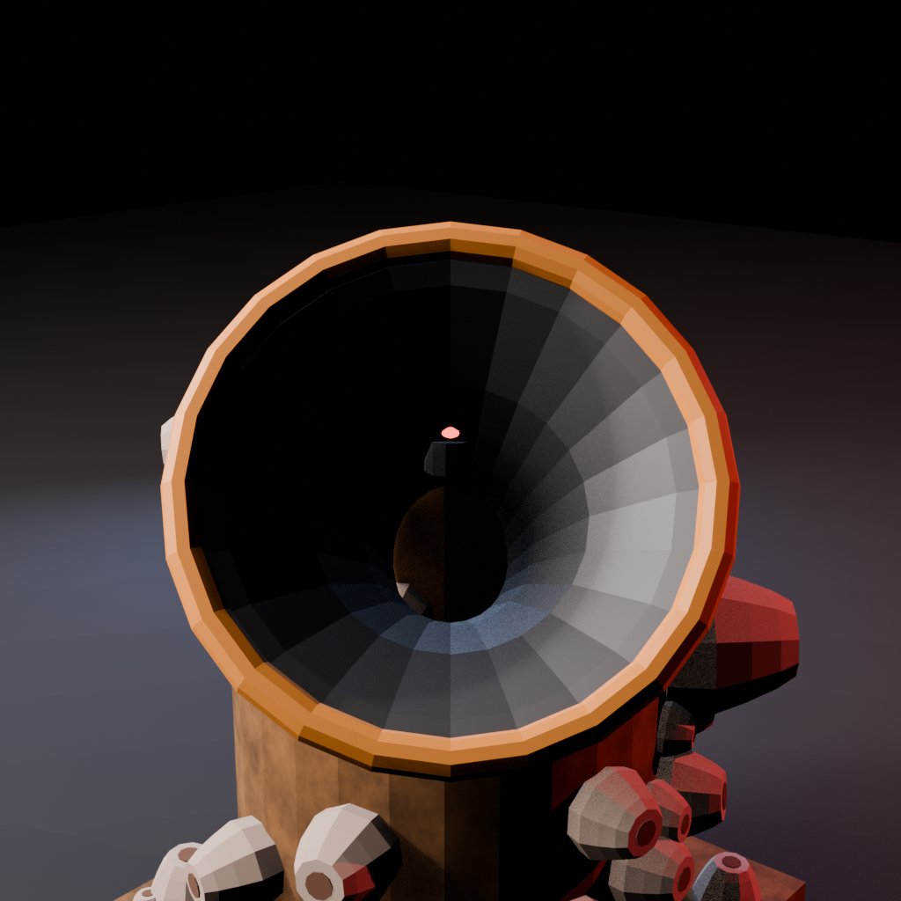

  

<h1 align="center">Use Your Friends</h1>

  <b>1-4 player co-op horror in the drowned facility ARGON-9.</b> 
  Your friends are the tools. The goo is recruiting.

## Download

| Version | File |
|---|---|
| **v0.18.0** (latest) | [Installer - 37 MB](https://github.com/grloper/use-your-friends-releases/releases/download/v0.18.0/UseYourFriends-Setup-v0.18.0.exe) - recommended, no admin needed |
| | [Portable ZIP - 51 MB](https://github.com/grloper/use-your-friends-releases/releases/download/v0.18.0/UseYourFriends-v0.18.0-Win64-portable.zip) - no install |
| [All releases](https://github.com/grloper/use-your-friends-releases/releases) | Older versions |

**Requires:** Windows 10/11. 1-4 players.

## What is this game?

**Your friends are the tools.** Morph into a plank, a spring, a ball. Cross the facility on each other's bodies. Every puzzle needs 2+ living players.

**The goo recruits the dead.** Your fallen friend comes back wrong - and hunts you.

**It's listening.** Every monster is heard before it's seen. Watch what you say.

---
[Source code](https://github.com/grloper/use-your-friends) - Proprietary. All rights reserved.
